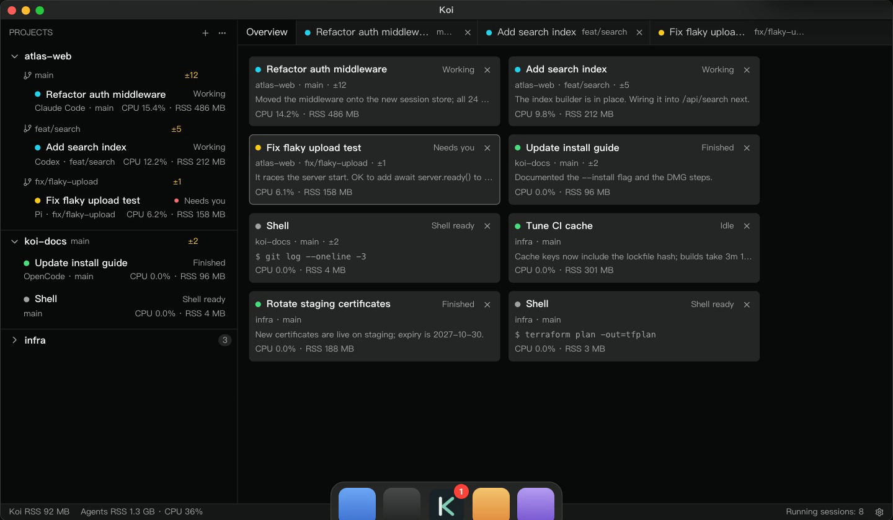
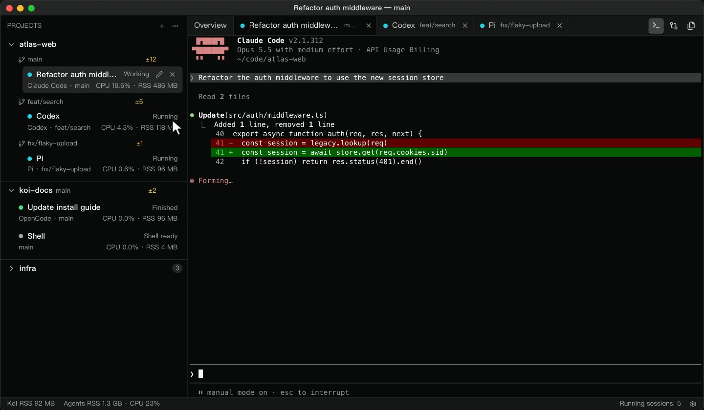
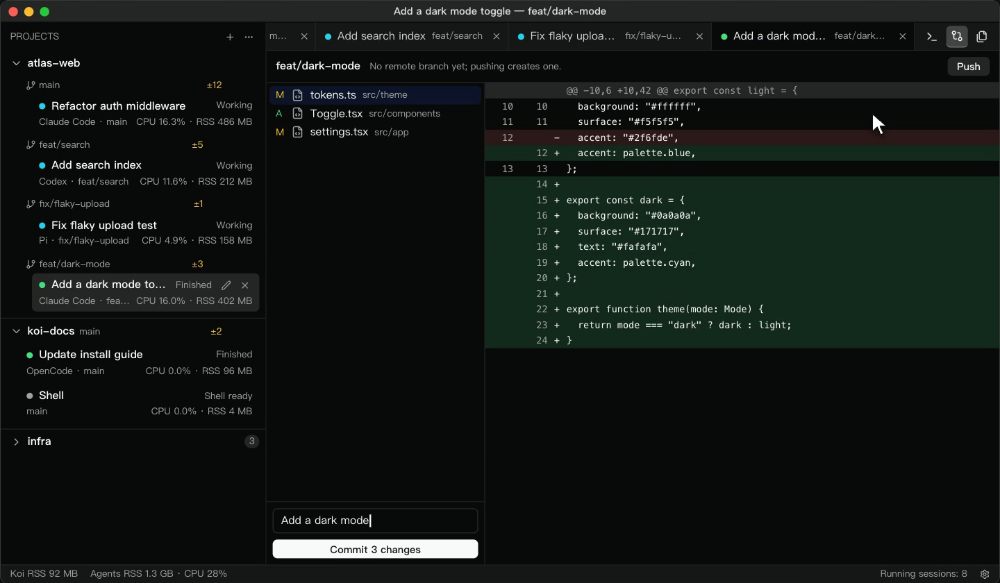
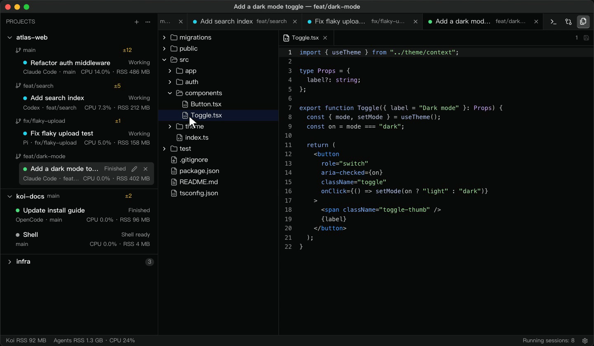

# Koi

A native macOS app for running and watching many CLI coding agents
(pi, Claude Code, Codex, OpenCode) from a single window.



## Features

- **Many agents at once.** Each agent runs in its own terminal tab, grouped by
  project and git worktree, with live CPU and memory use.
- **See who needs you.** The overview shows what every agent is doing; a
  notification and Dock badge tell you when one is waiting for input.
- **Review, commit, push.** Inspect a worktree's diff, commit and push without
  leaving Koi.
- **Browse and edit files** of the project beside the agent.
- **Pick up past conversations.** Search earlier agent sessions and resume
  one in a new tab.
- **Keep background services in check.** See the dev servers and watchers
  agents leave running, with their ports, and stop them in one click.

| Agents side by side | Review changes | Edit files |
| --- | --- | --- |
|  |  |  |

## Install

Requires macOS 13 or later.

```sh
brew install --cask jevin-f/koi/koi
```

Or download `Koi-<version>-arm64.dmg` (Apple Silicon) or
`Koi-<version>-x86_64.dmg` (Intel) from the
[latest release](https://github.com/Jevin-F/koi/releases/latest) and drag Koi
into Applications.

Koi is not notarized yet. The Homebrew cask clears the quarantine flag for you;
if macOS refuses to open a downloaded copy, run:

```sh
xattr -dr com.apple.quarantine /Applications/Koi.app
```

## Build

```sh
cargo run
```

The first build compiles GPUI and takes a few minutes; later builds are incremental.

System notifications only work when Koi runs as an app bundle:

```sh
scripts/bundle-macos.sh            # target/release/Koi.app
scripts/bundle-macos.sh --debug    # target/debug/Koi.app, faster to build
scripts/bundle-macos.sh --install  # moves it to /Applications/Koi.app
```

With `--install`, no copy is left in `target`, so Launchpad lists Koi once.

## Share a macOS installer

Run `scripts/package-macos.sh` to create a drag-to-Applications DMG, or pass
`--pkg` for a PKG installer. The package matches the build machine's
architecture. An unsigned package contains an ad-hoc-signed app, so Gatekeeper
may block it on another Mac.

For a package that opens normally on another Mac, join the Apple Developer
Program and install a **Developer ID Application** certificate in the login
keychain. A signed PKG additionally needs a **Developer ID Installer**
certificate. Save notarization credentials; this command prompts securely for
an app-specific password:

```sh
xcrun notarytool store-credentials koi --apple-id YOUR_APPLE_ID --team-id YOUR_TEAM_ID
```

Then build the signed and notarized DMG:

```sh
KOI_SIGN_IDENTITY="Developer ID Application: YOUR_NAME (TEAM_ID)" \
KOI_NOTARY_PROFILE=koi scripts/package-macos.sh
```

For a signed PKG, also set `KOI_INSTALLER_IDENTITY` and pass `--pkg`. The script
signs the app with the hardened runtime, submits the package for Apple's
notarization, and staples the ticket. Check available certificates with
`security find-identity -v -p codesigning`.

## Release

Set `version` in `Cargo.toml`, commit, then push a matching tag:

```sh
git tag v0.1.0 && git push origin v0.1.0
```

The release workflow builds unsigned DMGs for Apple Silicon and Intel and
publishes them as a GitHub release. Then update the cask in
[homebrew-koi](https://github.com/Jevin-F/homebrew-koi).

## Layout

| Path | Purpose |
| --- | --- |
| `crates/koi-app` | GPUI application: windows, menus, views; texts in `locales/app.toml` |
| `crates/koi-core` | Projects, git worktrees, agents, configuration, saved workspace (no UI) |
| `crates/koi-term` | Terminal sessions: PTY processes, screen state, input encoding (no UI) |
| `packaging/macos` | `Info.plist` for the app bundle |
| `docs/screenshots` | Images used in this README |
| `scripts` | Build helpers |

## License

[MIT](LICENSE)
